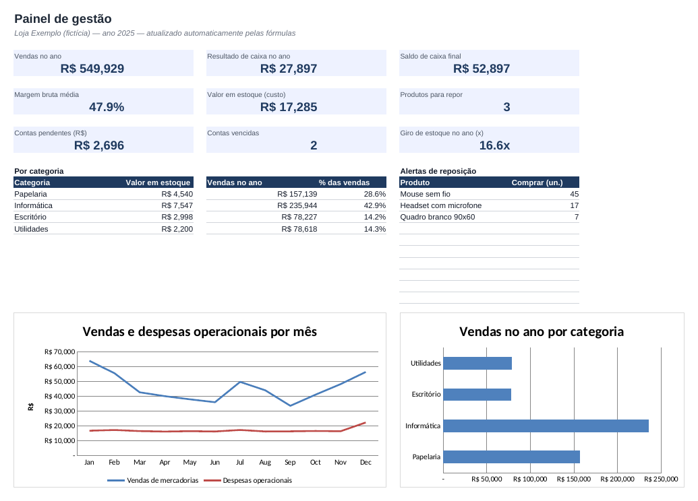
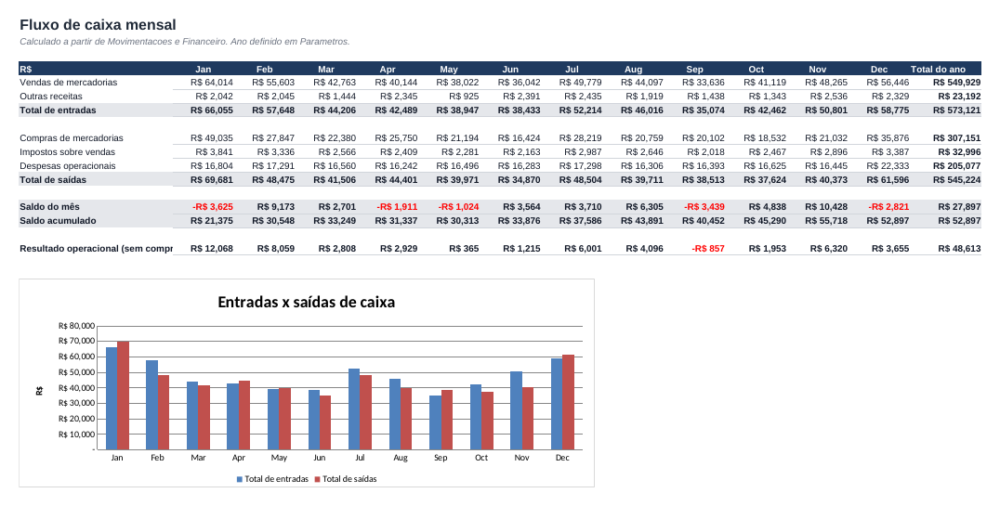

# Gestão de estoque e controle financeiro em Excel

**Planilha para pequeno comércio que controla estoque, calcula margens, monta o fluxo de caixa, projeta os próximos meses
e avisa o que precisa ser reposto. Tudo em fórmulas, com validação de dados e macros em VBA.**


📥 **[Baixar a planilha](planilha/Gestao_Estoque_Financeiro.xlsx)**

> A **Loja Exemplo** é uma empresa **fictícia**. Os produtos, movimentações e lançamentos que vêm na planilha foram gerados
> por [`scripts/gerar_planilha.py`](scripts/gerar_planilha.py) só para demonstrar o funcionamento. Apague os exemplos,
> digite os seus dados e tudo recalcula.



## O que a planilha faz

| Aba | Para que serve | O que é calculado |
|---|---|---|
| **Dashboard** | Visão geral do ano | Vendas, resultado e saldo de caixa, margem média, valor em estoque, giro, contas pendentes e vencidas, vendas por categoria, alertas de reposição e gráficos |
| **Parametros** | Premissas e listas | Ano, data de referência, saldo inicial, alíquota de impostos, crescimento projetado e listas de validação (nomes definidos usados nas fórmulas) |
| **Produtos** | Cadastro | Margem bruta, markup, entradas, saídas, estoque atual, valor em estoque, status (`OK`, `REPOR`, `SEM ESTOQUE`), sugestão de compra e vendas no ano |
| **Movimentacoes** | Entradas e saídas | Descrição do produto, valor total, ano e mês de cada lançamento (5.000 linhas com fórmulas prontas) |
| **Financeiro** | Receitas e despesas | Mês de competência e situação de cada conta (`Quitada`, `A vencer`, `VENCIDA`) |
| **Fluxo_Caixa** | Mês a mês | Vendas, outras receitas, compras, impostos, despesas, saldo do mês, saldo acumulado e resultado operacional |
| **Projecao** | Próximos 6 meses | Vendas, custo, impostos e resultado projetados a partir da média recente e da taxa de crescimento |
| **Lancamento** | Lançamento rápido | Mostra o produto, o estoque atual e o estoque depois do lançamento antes de gravar |



## Recursos de Excel usados

- **Fórmulas:** `SUMIFS`, `COUNTIF`, `INDEX`/`MATCH`, `SUMPRODUCT`, `OFFSET`, `IFERROR`, `DATE`/`YEAR`/`MONTH`.
- **Nomes definidos** para as premissas (`pAno`, `pAliquota`, `pCobertura`...), o que deixa as fórmulas legíveis e evita
  números fixos espalhados pela planilha.
- **Validação de dados:** listas de categorias, tipos e status; códigos de produto só do cadastro; quantidades inteiras e
  positivas; preços maiores que zero.
- **Formatação condicional:** produtos para repor ou sem estoque, contas vencidas, saldos negativos e margens abaixo de 30%.
- **Gráficos** de entradas x saídas, vendas x despesas e vendas por categoria.
- **Padrão de cores:** texto azul é entrada digitada, fundo amarelo é premissa, texto preto é fórmula.

## Macros (VBA)

Os módulos ficam em [`vba/`](vba/). Para usar: abra a planilha, pressione `Alt+F11`, vá em **Arquivo > Importar arquivo**,
importe os três `.bas` e salve como **Pasta de Trabalho Habilitada para Macro (.xlsm)**.

| Macro | Módulo | O que faz |
|---|---|---|
| `RegistrarMovimentacao` | `modMovimentacoes` | Lê a aba Lancamento, valida data, código, tipo e quantidade, **bloqueia saída maior que o estoque** e grava na próxima linha livre com o custo ou o preço do cadastro |
| `GerarRelatorioReposicao` | `modRelatorios` | Cria a aba Reposicao com os produtos abaixo do mínimo, a quantidade sugerida e o custo total da compra |
| `ExportarDashboardPDF` | `modRelatorios` | Exporta o painel em PDF na pasta da planilha, com a data no nome |
| `VerificarConsistencia` | `modValidacao` | Confere códigos não cadastrados, quantidades e tipos inválidos, datas fora do ano, preço abaixo do custo e contas vencidas, destacando as linhas com problema |
| `LimparDestaques` | `modValidacao` | Remove os destaques da verificação |

Os arquivos `.bas` estão em Windows-1252, a codificação que o Editor do VBA espera no Excel em português.

## Como a planilha foi construída

A planilha é gerada por código ([`scripts/gerar_planilha.py`](scripts/gerar_planilha.py), com `openpyxl`), o que deixa a
estrutura versionada e reproduzível. Depois de gerada, as fórmulas são recalculadas no LibreOffice para conferir que
**nenhuma das 21.635 fórmulas retorna erro**, e alguns resultados são conferidos contra os dados brutos (vendas do mês,
estoque de um produto, despesas e contas pendentes).

```bash
pip install openpyxl
python scripts/gerar_planilha.py
```

## Estrutura

```
├── planilha/Gestao_Estoque_Financeiro.xlsx   a planilha
├── vba/                                      módulos VBA para importar
├── scripts/gerar_planilha.py                 gera a planilha e os dados de exemplo
└── docs/                                     imagens do README
```

---

Feito por **Gabriel Veloso** · [LinkedIn](https://www.linkedin.com/in/gabrielvelosodev/) · [GitHub](https://github.com/GabrielVelosoDEV)
